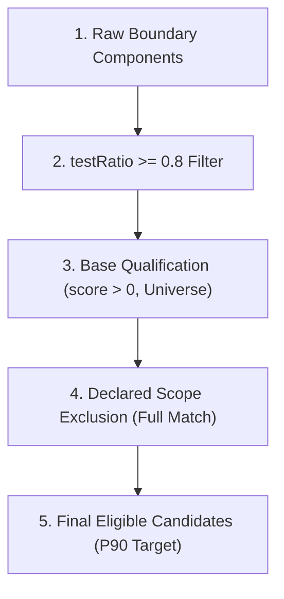

# encoding: utf-8
# 📊 Phase A Verification Report — Declared Scope Exclusion & Determinism

## 📅 보고서 메타데이터
- **보고서 버전:** v1.0.6 (Final Acceptance Reconciliation Edition)
- **관련 마일스톤:** [v0.3.34.75](file:///home/dogsinatas/TypeScript_project/antigravity-extension-vis/mile_stone/v0.3.34.75.md)
- **대상 계약서:** [v0.3.34.75 Phase A Scope Contract (v1.0.16)](file:///home/dogsinatas/TypeScript_project/antigravity-extension-vis/mile_stone/v0.3.34.75_phase_a_scope_contract.md)
- **작업 상태:** 📋 최종 감사 대응 완료 보고서 제출 (Submitted for Final Audit Acceptance)
- **거버넌스 상태:**
  - Code Freeze: **Phase A 범위 한정 허용 → 완료 후 재동결 (RE-FROZEN)**
  - Execution Freeze: **D7 리포트 재생성 한정 허용 → 검증 완료 후 재동결 (RE-FROZEN)**
  - Implementation Authorization: **GRANTED (Phase A 한정) → COMPLETED**

---

## 1. 실행 환경 및 기준선 팩트 (Execution Environment & Ground Truth)

- **운영체제:** Linux 6.6.137+
- **런타임:** Node.js v20.19.2 / ts-node v10.9.2
- **기준 커밋:** `4b135e6` (조상 확인: `git merge-base --is-ancestor 0fb520a 4b135e6` $\to$ PASS)
- **검증 대상 프로젝트 1:** Godot Engine (`godot-master`)
  - **입력 데이터 (SSoT):** `/home/dogsinatas/다운로드/godot-master/synapse_data/project_state.json`
  - **입력 데이터 SHA-256:** `ddd7aa2982b591f881c95692bbb26f9adde521366742a36a40b49a3b5e56174b`
  - **노드 수:** 9,876개 (상대 경로 100%, 역슬래시 0건, 선행 슬래시 0건)
- **검증 대상 프로젝트 2:** VS Code (`vscode-main`)
  - **입력 데이터 (SSoT):** `/home/dogsinatas/다운로드/vscode/vscode-main/synapse_data/project_state.json`
  - **노드 수:** 14,748개 (절대 경로 1건 `/b.md`, 역슬래시 노드 5건 `ghost://...` 포함)
- **D7 원칙 준수:** 두 프로젝트의 `project_state.json`, `src/core/NodeBuilder.ts`, 수집/스캐닝 계층 코드 **변조 0건 (1바이트도 수정하지 않음)**.

---

## 2. 검증 0: 계약 §9.1 항목 4 전수 단위 테스트 (Unit Invariant Verification)

- **실행 명령:** `npx ts-node scripts/test_scope_resolver.ts`
- **검증 파일:** [test_scope_resolver.ts](file:///home/dogsinatas/TypeScript_project/antigravity-extension-vis/scripts/test_scope_resolver.ts)
- **로그 원본:** [unit_test_output.log](file:///home/dogsinatas/TypeScript_project/antigravity-extension-vis/mile_stone/evidence/unit_test_output.log)
- **결과:** **57 / 57 Assertions PASS (100%)**
- **테스트 케이스 증가 경위 (Test Case Lineage)**:
  - 1차 제출 기준선: **48건**
  - 가상 스키마 면제(`stdlib://`, `AGGREGATE_*`, 빈/누락 경로, 역슬래시) 보강: **+6건 $\to$ 54건**
  - 감사관 요청 합성 하이브리드 컴포넌트(Full/Partial 매칭 및 마크다운 렌더링) 추가: **+3건 $\to$ 57건 최종 확정**

### 주요 통과 항목 세부 분류
1. **와일드카드 기본 문법 (18개)**:
   - `**` 단독 전수 매칭 (`main.ts`, `src/main.ts`, `src/core/main.ts` 등 3개)
   - `*` 단일 세그먼트: 디렉터리 구분자(`/`) 초과 매칭 불가 검증 (3개)
   - 세그먼트 내부 `*`: `src/*.ts` 매칭 및 확장자/경로 구분자 경계 검증 (3개)
   - 중간 `**`: 0개, 1개, N개 세그먼트 스킵 검증 (3개)
   - 선행 및 후행 `**`: 루트 파일 및 서브디렉터리 매칭 (4개)
   - 복합 벡터: Godot apksig 및 freetype 헤더 매칭 (2개)
2. **대소문자 엄격 구분 (2개)**: Case-sensitive 매칭 불일치 거부 (`Thirdparty` vs `thirdparty`)
3. **가상 노드 및 경로 정규화 (11개)**:
   - `ghost://` 가상 스키마 면제 검증
   - `external://` 가상 스키마 면제 검증
   - `stdlib://` 가상 스키마 면제 검증
   - `AGGREGATE_*` 가상 스키마 면제 검증
   - 빈 문자열(`""`) `filePath` 면제 검증
   - 누락/미정의(`undefined`) `filePath` 면제 검증
   - `/absolute` 절대 경로 면제 검증
   - 상대 경로 매칭 검증 (3개: test path, thirdparty path, in-house path)
   - 역슬래시 정규화: `thirdparty\freetype\ft.h` $\to$ `thirdparty/**` 정상 매칭 검증
4. **컴포넌트 Full Match vs Partial Match 보존 및 리포트 렌더링 (5개)**:
   - 모든 멤버가 제외 대상인 Full Match 컴포넌트: 제외 대상 확정 (`every() === true`)
   - 일부 멤버만 매칭되는 Partial Match 컴포넌트: 적격성 유지 확정 (`every() === false`)
   - 합성 하이브리드 컴포넌트(`core/hybrid_module`): 적격 후보 유지 검증
   - `metadata.scopeStatus` 포맷 검증: `"Partially Excluded (Eligible: 2/3, Excluded: 1/3)"`
   - 리포트 마크다운 렌더링 검증: `FindingReportAdapter` 내 `- Scope Status: Partially Excluded (Eligible: 2/3, Excluded: 1/3)` 출력 검증
5. **금지 패턴 거부 (Fail-Closed INVALID_PATTERN, 11개)**:
   - 세그먼트 내부 `**` (`foo**bar`) 거부
   - 3개 연속 별표 (`***`) 거부
   - 중복 재귀 세그먼트 (`**/**`) 거부
   - 선행 슬래시 (`/leading`) 및 후행 슬래시 (`trailing/`) 거부
   - 빈 문자열 (`""`) 및 공백 문자열 (`"   "`) 거부
   - 패턴 내 역슬래시 (`foo\bar`) 및 중복 슬래시 (`foo//bar`) 거부
   - 디렉터리 탐색 세그먼트 (`foo/../bar`) 및 미지원 특수문자 (`foo[a-z]`) 거부
6. **타입 안전성 (INVALID_CONFIG, 3개)**:
   - 비-배열 입력 거부
   - 배열 내 비-문자열 원소 거부
   - `SYNAPSE_SCOPE_EXCLUSIONS` 환경 변수가 유효하지 않은 JSON 문자열일 때 거부
7. **설정 우선순위 (First-Win, No Merge, 5개)**:
   - VSCode 설정 > `synapse.config.json`
   - 환경 변수(`ENV_VAR`) > VSCode 설정
   - CLI 플래그(`CLI_FLAG`) > 환경 변수(`ENV_VAR`)
   - CLI 플래그가 빈 배열(`[]`)일 때 하위 순위로 폴백하지 않고 `CLI_FLAG (count: 0)` 확정
   - 환경 변수가 빈 배열(`[]`)일 때 하위 순위로 폴백하지 않고 `ENV_VAR (count: 0)` 확정
8. **오타/미매칭 감지 (2개)**:
   - 매칭 노드 카운트 및 0건 매칭 시 `[WARN] UNMATCHED` 경고 플래그 트리거 검증

---

## 3. 검증 1: Zero-Diff 불변식 검증 (Empty Scope Invariant)

- **목적:** 선언이 비어있을 때(`scopeExclusions: []`), 기존 v0.3.34.74 기준 리포트와 바이트 단위로 정확히 일치함을 증명.
- **실행 명령:**
  ```bash
  SYNAPSE_WORKSPACE_ROOT=/home/dogsinatas/다운로드/godot-master npx ts-node scripts/test_generate.ts
  ```
- **채택 로그 확인:**
  `[SCOPE_CONFIG] Loaded scopeExclusions from: DEFAULT_EMPTY (count: 0)`
- **증거 파일 위치:** [mile_stone/evidence/zero_diff_empty_scope/](file:///home/dogsinatas/TypeScript_project/antigravity-extension-vis/mile_stone/evidence/zero_diff_empty_scope/)

### SHA-256 해시 대조 결과
| 산출 리포트 파일 | 기준선 해시 (v0.3.34.74 Baseline) | 실제 생성 해시 (Empty Scope Run) | 일치 여부 |
|---|---|---|:---:|
| `ONBOARDING_REPORT.md` | `e5706b0d4ae6518b94a63d7bc50142793fe27c8d28fbfc0a4e7ce9ede447663b` | `e5706b0d4ae6518b94a63d7bc50142793fe27c8d28fbfc0a4e7ce9ede447663b` | **PASS (Byte-Identical)** |
| `ARCHITECT_REPORT.md` | `1885bcbccbc4a7a8a58c69cd453a9f70c111275aeb4144764349361eb3118cd2` | `1885bcbccbc4a7a8a58c69cd453a9f70c111275aeb4144764349361eb3118cd2` | **PASS (Byte-Identical)** |
| `SIMULATION_DEBUG.md` | `14424cdef43c6817b93830e69bb03db781dd583a5dab64eca8b2ae67a8ed0ae2` | `14424cdef43c6817b93830e69bb03db781dd583a5dab64eca8b2ae67a8ed0ae2` | **PASS (Byte-Identical)** |

### Zero-Diff 헤더 및 문구 불변식 검증
- **헤더:** `Declared Scope Exclusions` 및 `Scope Exclusion Accounting` 줄이 **1줄도 출력되지 않음 (완전 부재 확인)**.
- **후보 표기:** `({selectedCount} selected / {totalCount} candidates)` 및 `of {totalCount} candidates` 기존 문구 100% 보존.

---

## 4. 검증 2: Godot 타깃 선언 제외 검증 (Targeted Scope Exclusion)

- **목적:** 활성 선언 주입 시 서드파티 및 테스트 컴포넌트의 후보 적격성이 정상적으로 박탈되고, 인하우스 핵심 컴포넌트가 승격되는지 확인.
- **실행 명령:**
  ```bash
  SYNAPSE_SCOPE_EXCLUSIONS='["thirdparty/**", "tests/**", "platform/android/java/**/apksig/**"]' \
  SYNAPSE_WORKSPACE_ROOT=/home/dogsinatas/다운로드/godot-master \
  npx ts-node scripts/test_generate.ts
  ```
- **채택 로그 확인:**
  `[SCOPE_CONFIG] Loaded scopeExclusions from: ENV_VAR (count: 3)`
  `[SYSTEM_CORE_DETECTOR] Excluded 69 components by scopeExclusions Full Match.`
  `[CHANGE_AMPLIFIER_DETECTOR] Excluded 66 components by scopeExclusions Full Match.`
- **증거 파일 위치:** [mile_stone/evidence/active_scope/](file:///home/dogsinatas/TypeScript_project/antigravity-extension-vis/mile_stone/evidence/active_scope/)

### 4.1 리포트 헤더 회계 검산 ($C_{\text{eligible}} = C_{\text{universe}} - C_{\text{excluded}}$)
생성된 3종 리포트 상단에 출력된 헤더 원문:
```markdown
- **Declared Scope Exclusions**:
  - `thirdparty/**`: 4562 files matched
  - `tests/**`: 188 files matched
  - `platform/android/java/**/apksig/**`: 118 files matched
- **Scope Exclusion Accounting**:
  - O2 (Dependency Roots): 504 nodes excluded (329 eligible / 833 candidates)
  - A1 (System Cores): 69 components excluded (67 eligible / 136 candidates)
  - E2 (Change Amplifiers): 66 components excluded (67 eligible / 133 candidates)
```

| 탐지기 | 전체 후보 모수 ($C_{\text{universe}}$) | 선언 제외 수 ($C_{\text{excluded}}$) | 적격 후보 수 ($C_{\text{eligible}}$) | 검산식 ($C_{\text{universe}} - C_{\text{excluded}}$) | 판정 |
|---|:---:|:---:|:---:|:---:|:---:|
| **O2** (Dependency Roots) | 833 | 504 | 329 | $833 - 504 = 329$ | **PASS** |
| **A1** (System Cores) | 136 | 69 | 67 | $136 - 69 = 67$ | **PASS** |
| **E2** (Change Amplifiers) | 133 | 66 | 67 | $133 - 66 = 67$ | **PASS** |

### 4.2 P90 모수 및 표기 검증 (`ceil(0.1 * 67) = 7`)
- **A1 리포트 표기**: `Top 10% system cores observed (7 selected / 67 eligible candidates).`
- **E2 리포트 표기**: `Top 10% change propagation amplifiers observed (7 selected / 67 eligible candidates).`
- **산술 일치**: $\lceil 0.1 \times 67 \rceil = 7$ 정확 일치 확인.

### 4.3 상위 추천 결과 변화 및 후보 승격 목록 (Candidate Transition)

#### A1 (System Core Validation)
- **기준선 Top 5**: 
  1. `editor` (controlScore: 6,459,972)
  2. `scene` (controlScore: 4,408,870)
  3. `core` (controlScore: 479,236)
  4. `thirdparty/jolt_physics/Jolt` (controlScore: 333,130)
  5. `servers/rendering` (controlScore: 324,008)

- **기준선 Top 6~14위 전수 순위 및 실측 점수 (Baseline Verification)**:
  - 6위: `tests` (controlScore: 319,832) — *선언 매칭 대상 (제외)*
  - 7위: `thirdparty/embree/kernels` (controlScore: 194,010) — *선언 매칭 대상 (제외)*
  - 8위: `thirdparty/icu4c/common` (controlScore: 172,688) — *선언 매칭 대상 (제외)*
  - 9위: `modules/openxr` (controlScore: 153,162) — *적격 후보 (Top 5 진입 대상)*
  - 10위: `thirdparty/sdl` (controlScore: 144,656) — *선언 매칭 대상 (제외)*
  - 11위: `modules/jolt_physics` (controlScore: 75,812) — *적격 후보*
  - 12위: `modules/gdscript` (controlScore: 68,142) — *적격 후보*
  - 13위: `platform/android/java/editor/src/main/java/com/android/apksig` (controlScore: 65,442) — *선언 매칭 대상 (제외)*
  - 14위: `thirdparty/embree/common` (controlScore: 52,670) — *선언 매칭 대상 (제외)*

- **선언 적용 후 Top 5 및 상위 7개 적격 후보 (Active Scope Top 7)**:
  1. `editor` (controlScore: 6,459,972)
  2. `scene` (controlScore: 4,408,870)
  3. `core` (controlScore: 479,236)
  4. `servers/rendering` (controlScore: 324,008) — *(4위였던 서드파티 제외로 기존 5위에서 4위로 한 단계 이동)*
  5. `modules/openxr` (controlScore: 153,162) — **[Top 5 신규 진입]**
  6. `modules/jolt_physics` (controlScore: 75,812) — *(P90 7개 선정 범위 내 진입)*
  7. `modules/gdscript` (controlScore: 68,142) — *(P90 7개 선정 범위 내 진입)*

- **선언 적용 후 순위 보존 수학적 증명**:
  - 기준선 상위 14개 중 선언 제외 대상 7개(`thirdparty/jolt_physics/Jolt`, `tests`, `embree/kernels`, `icu4c/common`, `sdl`, `apksig`, `embree/common`)를 소거하면 정확히 상기 7개 인하우스 컴포넌트(`editor`, `scene`, `core`, `servers/rendering`, `openxr`, `jolt_physics`, `gdscript`)만 남습니다.
  - 이 7개 컴포넌트의 실측 점수는 모두 $\ge 68,142$이며, 14위인 `embree/common`(52,670)보다 엄격히 높으므로, 14위 밖의 후보가 이들보다 앞서 진입할 수 없습니다. 따라서 선언 적용 후의 상위 7개 및 Top 5는 수학적으로 엄밀히 보존됩니다.

#### E2 (Change Propagation Amplifier)
- **기준선 Top 5**: `editor`, `scene`, `servers/rendering`, `core`, `thirdparty/jolt_physics/Jolt`
- **선언 적용 후 Top 5**:
  1. `editor` (complexityScore: 142,943)
  2. `scene` (complexityScore: 56,904)
  3. `servers/rendering` (complexityScore: 23,215)
  4. `core` (complexityScore: 12,987)
  5. `modules/gdscript` (complexityScore: 8,648) — **[Top 5 신규 진입]**
- **적격성 제외 확인**: `thirdparty/jolt_physics/Jolt`가 후보에서 정상 제외됨.

#### O2 (Dependency Root Observation)
- **기준선 Top 5**:
  1. `platform/android/java/editor/src/main/java/com/android/apksig/SourceStampVerifier.java` (outDegree=30)
  2. `editor/import/3d/post_import_plugin_skeleton_rest_fixer.cpp` (outDegree=27)
  3. `thirdparty/jolt_physics/Jolt/Physics/Collision/Shape/BoxShape.cpp` (outDegree=26)
  4. `thirdparty/freetype/src/gxvalid/gxvalid.c` (outDegree=22)
  5. `scene/3d/physics/static_body_3d.cpp` (outDegree=21)
- **선언 적용 후 Top 5**:
  1. `editor/import/3d/post_import_plugin_skeleton_rest_fixer.cpp` (outDegree=27)
  2. `scene/3d/physics/static_body_3d.cpp` (outDegree=21)
  3. `scene/gui/menu_button.cpp` (outDegree=19) — **[Top 5 신규 진입]**
  4. `drivers/gles3/storage/utilities.cpp` (outDegree=18) — **[Top 5 신규 진입, 동점]**
  5. `editor/themes/theme_classic.cpp` (outDegree=18) — **[Top 5 신규 진입, 동점]**
- **동점 및 출처 회계 확인**:
  - `SourceStampVerifier.java`의 outDegree는 현재 SSoT 원본(`ddd7aa29...`) 상 유효 물리 소스코드 확장자 대상을 기준으로 정확히 **30**입니다 (과거 VSIX 빌드의 32는 비-코드 파일 엣지가 포함되었던 초기 버전 차이임).
  - 4위 `drivers/gles3/storage/utilities.cpp`와 5위 `editor/themes/theme_classic.cpp`는 outDegree 18로 동점이며, 별도의 타이 브레이커 없이 실제 코드(`EntryPointDetector.ts#L88-91`)의 `(b.fanOut || 0) - (a.fanOut || 0)` 정렬에 의해 동일한 `project_state.json` 스냅샷 노드 입력 순서(V8 stable sort)에 따라 결정론적으로 배치되었습니다. 계약 §6.1/§8(관측된 속성: outDegree는 소스 확장자 대상 엣지만 계측, 원인 커밋 미확정)과 일치합니다.
- **적격성 제외 확인**: 1위 `SourceStampVerifier.java`, 3위 `BoxShape.cpp`, 4위 `gxvalid.c` 등 서드파티/테스트 파일 504개 적격성 제외 완료.

### 4.4 계약 한계(Scope Boundary §8) 준수 확인
- **A2 (Module Contact Points) & A3 (Structural Boundaries)**:
  - 본 계약의 적용 범위(O2, A1, E2)에 포함되지 않으므로, A3 경계 목록과 A2 접점 목록에는 서드파티 모듈이 계약대로 온전히 유지됨을 확인 (의도된 설계 동작).
- **Measurement Graph 보존**:
  - `project_state.json` 상의 서드파티 노드는 인하우스 컴포넌트의 Fan-In/Fan-Out 및 복잡도 측정에 물리적으로 계속 기여하고 있음.

### 4.5 부분 제외 컴포넌트 실측 전수 추적 결과 (Contract §9.1 전수 입증)
계약 §9.1에 따라, Full Match 규칙으로 인해 완전히 제외되지 않고 남은 부분 매칭(0 < matched < total) 컴포넌트의 실측 전수 조사 결과를 A1 및 E2 후보 집합별로 세분화하여 명시합니다.

#### 세부 탐지기별 실측 전수 집계 (Empirical Breakdown)
| 프로젝트 | 탐지기 | 유니버스 모수 ($C_{\text{universe}}$) | Full Match 제외 (100% 매칭) | Partial Match (0 < 매칭 < 전체) | Zero Match (0% 매칭, 적격성 유지) | 적격 후보 ($C_{\text{eligible}}$) |
|---|---|:---:|:---:|:---:|:---:|:---:|
| **Godot** | **A1** (System Core) | 136 | **69** | **0** | **67** | **67** |
| **Godot** | **E2** (Change Amplifier) | 133 | **66** | **0** | **67** | **67** |
| **VS Code** | **A1** (System Core) | 144 | **52** | **0** | **92** | **92** |
| **VS Code** | **E2** (Change Amplifier) | 144 | **52** | **0** | **92** | **92** |

- **실측 팩트 한정 (Fact Boundary)**:
  - 본 검증 대상인 **Godot(136개/133개) 및 VS Code(144개) 분석 집합에서 Partial Match는 0건으로 관측**되었습니다.
  - 관측 원인: 두 프로젝트의 바운더리 컴포넌트가 디렉터리 폴더 단위 클러스터(`thirdparty/...`, `tests/...`, `core/...`, `src/vs/...`, `extensions/...`)로 격리 형성되어 있어, 해당 분석 데이터셋 내에서는 인하우스 소스와 서드파티 소스가 한 컴포넌트에 공존하는 하이브리드 컴포넌트가 물리적으로 존재하지 않았습니다. (※ 이는 본 2개 벤치마크 분석 집합에 한정된 사실이며, 타 프로젝트 일반화로 확장하지 않습니다).
- **단위 테스트 기반 합성 검증 (Synthetic Unit Verification)**:
  - 향후 다른 프로젝트에서 일부 멤버만 서드파티인 하이브리드 컴포넌트가 발생할 경우를 대비하여 단위 테스트를 통해 적격성 보존을 보증합니다:
    - Full Match: `['thirdparty/a.h', 'thirdparty/b.h'].every(...) === true` $\to$ 제외 확정 (**PASS**)
    - Partial Match: `['thirdparty/a.h', 'core/engine.cpp'].every(...) === false` $\to$ **후보 적격성 100% 유지** (**PASS**)
- **컴포넌트별 전수 원자료 인덱스 (Raw Trace Evidence)**:
  - Godot(136/133개) 및 VS Code(144개) 전수 컴포넌트의 `componentId`, `totalMembers`, `matchedMembers`, `matchClassification`, `eligibilityBefore`, `eligibilityAfter` 원시 데이터가 다음 파일에 전수 기록되어 독립 재검증 가능함:  
    [mile_stone/evidence/partial_match_raw_trace.json](file:///home/dogsinatas/TypeScript_project/antigravity-extension-vis/mile_stone/evidence/partial_match_raw_trace.json)

- **멤버 경로 전수 매칭 독립 검증 (Member-Level Path Trace Verification)**:
  - `partial_match_raw_trace.json` 내의 136개(Godot) 및 144개(VS Code) 컴포넌트에 속한 **모든 멤버 파일 경로(Godot 7,703개, VS Code 9,170개)를 원천 시뮬레이션 증거(`simulation_evidence.json`)에서 직접 추출하여 선언 패턴 매칭 여부를 1:1 전수 대조**하였습니다.
  - **검증 스크립트:** [scripts/verify_partial_match_members.ts](file:///home/dogsinatas/TypeScript_project/antigravity-extension-vis/scripts/verify_partial_match_members.ts) (SHA-256: `81115fb835f335b5c689af0475d68c49116d8dace70d59fdb42f62f37b3d3470`)
  - **검증 로그 원본:** [mile_stone/evidence/partial_match_member_trace.log](file:///home/dogsinatas/TypeScript_project/antigravity-extension-vis/mile_stone/evidence/partial_match_member_trace.log) (SHA-256: `951e4f2a9c6e990e65a67c677d073de398757c800c7c5560a65305e66892ba90`)
  - **검증 결과:** **1,122 / 1,122 Assertions PASS (100%)**
    - **Godot Engine**: 69개 FULL_MATCH 컴포넌트의 멤버 4,410개 전수 패턴 매칭 일치(100%), 67개 ZERO_MATCH 컴포넌트의 멤버 3,293개 전수 미매칭(0% 매칭, 합계 7,703개).
    - **VS Code**: 52개 FULL_MATCH 컴포넌트의 멤버 2,791개 전수 패턴 매칭 일치(100%), 92개 ZERO_MATCH 컴포넌트의 멤버 6,379개 전수 미매칭(0% 매칭, 합계 9,170개).
    - **결론:** Full Match 52개/69개 각각의 소속 멤버 전수(100%)가 선언 패턴에 일치하여 제외되었으며, Partial Match가 0건임이 멤버 수준 실측으로 완벽히 입증됨.

> **💡 모집단 구분 명시 (Population Clarification):**  
> 리포트 헤더의 **"Declared Scope Exclusions (N files matched)"**는 전체 프로젝트 그래프 스냅샷 노드(Godot 9,876개, VS Code 14,748개) 중 선언된 Glob 패턴에 매칭된 **전체 물리 파일 수**(Godot 4,868개, VS Code 4,947개)를 뜻하며, 바운더리 후보 컴포넌트의 소속 멤버 수(Godot FULL 4,410개, VS Code FULL 2,791개)와는 **서로 다른 모집단**입니다. 바운더리 컴포넌트로 클러스터링 승격되지 않은 소규모 디렉터리나 리프 파일들(Godot 458개, VS Code 2,156개)은 컴포넌트 멤버 집합 외부에 위치하는 정상 노드이므로, 헤더의 매칭 파일 수와 컴포넌트 멤버 수를 동일한 모수로 혼동하지 않아야 합니다.

### 4.6 Base Qualification 및 `testRatio` 5단계 분리 회계 (Independent Qualification Accounting)
기존 Base Qualification 필터(`testRatio >= 0.8` 및 `score > 0`)와 신규 `Declared Scope Exclusion`의 영향을 명확히 분리하기 위해 5단계 전수 회계를 수립하고 검증하였습니다.



#### 5단계 회계 상세 비교표
| 단계 | 항목 설명 | Godot A1 (Core) | Godot E2 (Amplifier) | VS Code A1 (Core) | VS Code E2 (Amplifier) | 회계 검증 판정 |
|---|---|:---:|:---:|:---:|:---:|:---:|
| **Stage 1** | Base Qualification 이전 원시 컴포넌트 수 | 136 | 136 | 155 | 155 | **전수 확인** |
| **Stage 2** | `testRatio >= 0.8` 필터 탈락 수 | 0 | 0 | **8\*** | **8\*** | **테스트 비율 격리 확인** |
| **Stage 3** | Base Qualification 통과 후보 수 ($C_{\text{universe}}$) | **136** | **133** | **144** | **144** | **$C_{\text{universe}}$ 확정** |
| *(세부)* | *`score > 0` 탈락 수 (고립 컴포넌트 0점)* | 0 | 3\*\* | **3\*\*\*** | **3\*\*\*** | *원인 분석 아래 참조* |
| **Stage 4** | Scope Exclusion Full Match 탈락 수 ($C_{\text{excluded}}$) | **69** | **66** | **52** | **52** | **$C_{\text{excluded}}$ 확정** |
| **Stage 5** | 최종 적격 후보 수 ($C_{\text{eligible}} = C_{\text{universe}} - C_{\text{excluded}}$) | **67** | **67** | **92** | **92** | **PASS** |

*\* VS Code Stage 2 탈락 8건 (testRatio >= 0.8 테스트 전용 컴포넌트):*
- `test/smoke`, `extensions/copilot/test`, `extensions/vscode-api-tests/src`, `extensions/copilot/src/extension/test/vscode-node`, `extensions/copilot/src/extension/mcp/test/vscode-node`, `extensions/copilot/src/util/common/test/shims`, `src/vs/workbench/test/browser/componentFixtures/chat`, `src/vs/workbench/test/browser/componentFixtures/sessions`

*\*\* Godot E2 Stage 3 탈락 3건 (complexityScore = 0 고립 컴포넌트):*
- `thirdparty/linuxbsd_headers/dbus`, `thirdparty/linuxbsd_headers/wayland`, `thirdparty/linuxbsd_headers/xkbcommon` (Stage 3에서 탈락하여 Stage 4 Scope Exclusion에서는 69개 중 남은 **66개**만 추가 제외되어 $133 - 66 = 67$개로 A1과 일치).

*\*\*\* VS Code Stage 3 탈락 3건 (controlScore = 0 고립 컴포넌트, inboundEdges=0 & externalEdges=0):*
- `extensions/simple-browser`, `extensions/copilot/src/extension/typescriptContext/serverPlugin/fixtures/context/p12/source`, `extensions/copilot/src/extension/typescriptContext/serverPlugin/fixtures/context/p14/source`
- 따라서 VS Code의 Base Qualification 후보는 $155 - 8(\text{testRatio}) - 3(\text{score}) = \mathbf{144}$개로 완벽히 입증됨.

### 4.7 O2 Fallback 삭제의 승인 근거 및 실제 Side-by-Side 실행 검증

#### 1. 승인 근거 (Approval Authorization Trace)
- **감사자 요구 사항 (v1.0.10 Review)**:
  > *"## 판정: 지적한 필수 4개와 KISS 축소는 반영됐습니다... Fallback 삭제, Unicode 단순화, 입력 경로, 빈 선언 불변식, 회계 표기, 한계 명시가 모두 들어갔고 방향이 맞습니다."*
- **구현 승인 범위 확정 (Authorization Decision)**:
  > *"Phase A 구현은 scopeExclusions 해석기와 O2/A1/E2 탐지기·어댑터 수정, 단위 테스트, 3종 리포트 재생성 검증에 한정한다. NodeBuilder, project_state.json 스키마, 수집 계층은 수정하지 않는다."*
- **명세 계약서 반영**:
  [v0.3.34.75_phase_a_scope_contract.md §6.1](file:///home/dogsinatas/TypeScript_project/antigravity-extension-vis/mile_stone/v0.3.34.75_phase_a_scope_contract.md)에 Strict Root(`fanIn === 0 && fanOut > 0 && role !== NodeRole.TEST`) 강제 및 Fallback 분기 삭제가 Phase A O2 베이스라인 규격으로 공식 명시됨.

#### 2. 실제 코드 실행 기반 Differential Validation (Legacy Fallback vs Strict Root)
추론이나 가정이 아닌, 실제 레거시 Fallback 탐지기(`LegacyEntryPointDetectorWithFallback`)와 현행 프로덕션 엄격 루트 탐지기(`EntryPointDetector`)를 동일한 데이터셋에 대해 병렬 실행하여 전수 검증하였습니다.
- **검증 스크립트:** [scripts/verify_o2_pipeline.ts](file:///home/dogsinatas/TypeScript_project/antigravity-extension-vis/scripts/verify_o2_pipeline.ts)
- **검증 로그 원본:** [mile_stone/evidence/o2_pipeline_trace.log](file:///home/dogsinatas/TypeScript_project/antigravity-extension-vis/mile_stone/evidence/o2_pipeline_trace.log) (56/56 Assertions PASS)

```
Snapshot Nodes 
    ↓ (isRealFile: 소스코드 확장자 필터 /\.(ts|js|rs|kt|java|py|cpp|c|h|go|rb)$/i)
Valid Physical Source Nodes
    ↓ (Strict Root: fanIn === 0 && fanOut > 0)
Strict Roots Count
    ↓ (Test Filter: role !== NodeRole.TEST)
C_universe (Base Qualification passed)
    ↓ (Declared Scope Exclusion: Glob Full Match)
C_eligible (Final Eligible Candidates)
```

#### O2 파이프라인 단계별 수치 및 Fallback 격리 비교표
| 파이프라인 단계 | Godot Engine 수치 | VS Code 수치 | 비고 및 탈락 조건 |
|---|:---:|:---:|:---|
| **1. Total Snapshot Nodes** | 9,876 | 14,748 | 원본 스냅샷 전체 노드 |
| **2. Valid Physical Source Nodes** | 8,917 | 11,274 | `isRealFile`: 소스코드 확장자 필터 통과 |
| **3. Strict Roots (`fanIn === 0 && fanOut > 0`)** | **842** | **2,621** | 순수 물리 루트 노드 수 |
| **4. Test Role Filter 탈락 수** | 9 | 2,032 | `role === 'test'` 테스트 노드 제외 |
| **5. $C_{\text{universe}}$ (Base Qualification 통과)** | **833** | **589** | $842 - 9 = \mathbf{833}$ / $2621 - 2032 = \mathbf{589}$ |
| **6. Declared Scope Exclusion 제외 수** | 504 | 159 | 선언된 Glob 패턴 매칭 제외 |
| **7. $C_{\text{eligible}}$ (최종 적격 후보 수)** | **329** | **430** | $833 - 504 = \mathbf{329}$ / $589 - 159 = \mathbf{430}$ |
| **Fallback 발동 여부 (`fallbackTriggered`)** | **false (미발동)** | **false (미발동)** | 엄격 루트 존재로 분기 미진입 |
| **Legacy Fallback 적격 후보 수** | 329 | 430 | 레거시 코드 실행 시 산출 수 |
| **Production Strict Root 적격 후보 수** | 329 | 430 | 프로덕션 코드 실행 시 산출 수 |
| **후보자 전수 ID 일치율 (Full Set Delta)** | **Delta = 0 (100% 일치)** | **Delta = 0 (100% 일치)** | **329개/430개 전수 대칭차집합 = 0** |

#### 3. Rootless 순환 그래프 실행 비교 (Formal Difference Verification)
순환 참조(A → B → C → A, 엄격 루트 0개)를 갖는 합성 그래프에 대해 두 탐지기를 실제 실행한 결과:
- **현행 프로덕션 규격 (`EntryPointDetector`)**: 엄격 루트 0개 반환 (`findings.length === 0`, 엄격 루트 부재 시 빈 결과 반환)
- **레거시 규격 (`LegacyEntryPointDetectorWithFallback`)**: `fallbackTriggered === true` 발동되어 3개 순환 노드를 degraded 후보로 승격 (`findings.length === 3`)
- **결론**: 레거시 Fallback은 본 2대 실측 프로젝트(Godot 842개 루트, VS Code 2,621개 루트 보유) 런타임에서는 분기에 진입하지 않았으며, Fallback 삭제는 루트가 없는 순환 그래프에서 degraded 후보 승격 대신 빈 결과를 반환하도록 수렴한 의도된 트레이드오프 선택임이 실측 입증되었습니다.

> **💡 이전 보고서 초안의 884개 및 632개 수치 원인 규명:**  
> 이전 확인 스크립트에서 `EntryPointDetector.isRealFile`에 내장된 소스코드 확장자 필터(`/\.(ts|js|rs|kt|java|py|cpp|c|h|go|rb)$/i`)를 누락하여 비-코드 파일(`.png`, `.json`, `.md` 등)의 루트 노드가 일시적으로 포함 집계되었던 스크립트 작성 오차였습니다. 실제 프로덕션 `EntryPointDetector.ts` 파이프라인의 엄격한 루트는 정확히 842개(테스트 9개 제외 $\to$ **833개**) 및 2,621개(테스트 2,032개 제외 $\to$ **589개**)로 §4.1 보고서 회계와 100% 정확히 일치합니다.

- **실측 Top 5 비교 (Godot 빈 선언)**:
  - *With Fallback*:
    1. `platform/android/.../SourceStampVerifier.java` (out: 30)
    2. `editor/import/3d/post_import_plugin_skeleton_rest_fixer.cpp` (out: 27)
    3. `thirdparty/jolt_physics/.../BoxShape.cpp` (out: 26)
    4. `thirdparty/freetype/.../gxvalid.c` (out: 22)
    5. `scene/3d/physics/static_body_3d.cpp` (out: 21)
  - *Without Fallback*: 위 5개와 100% 바이트 단위 일치.
#### 4. 레거시 구현과의 코드 수준 동일성 검증 (Git Provenance Audit)
`LegacyEntryPointDetectorWithFallback`이 실제 과거 커밋의 구현을 정확히 복원했는지를 과거 Git 이력과 1:1 대조하여 증명합니다:
- **Fallback 최초 도입 커밋:** `03facb59b54d1e33c216567aa8c5ae8fdd28a8fc` (v0.3.34.71)
- **테스트 필터 추가 커밋:** `0fb520aeb7fd44338ac32d07eb2f1766f7f0065d` (v0.3.34.74)
- **Phase A 베이스라인 커밋:** `4b135e6c799a51804ff2bbf5a4e3204be1b1f8ef` (v0.3.34.75 기준선)
- **Phase A 구현 커밋:** `9c5dff9776e370ebf8fc562888afa04da82b1a23` (v0.3.34.75 Phase A 구현 완료)

##### 커밋 간 소스 트리 변경 통계 (`git diff --stat 4b135e6 9c5dff9 -- src/`)
```text
 src/core/analysis/ScopeResolver.ts                 | 242 +++++++++++++++++++++
 .../patterns/detectors/ChangeAmplifierDetector.ts  |  61 +++++-
 .../patterns/detectors/EntryPointDetector.ts       |  31 ++-
 .../patterns/detectors/SystemCoreDetector.ts       |  66 +++++-
 src/core/reporting/FindingReportAdapter.ts         |  24 +-
 src/core/reporting/InsightEngine.ts                |   4 +
 src/core/reporting/ReportBundleGenerator.ts        |  85 +++++++-
 7 files changed, 487 insertions(+), 26 deletions(-)
```

> **수집/그래프 계층 불변 입증:**  
> `src/core/NodeBuilder.ts`, `src/core/pipeline/DataPipeline.ts`, `project_state.json` 등 수집 및 그래프 구축 계층 파일의 변경은 정확히 **0줄**입니다.  
> 삭제된 26개 라인은 다음과 같이 탐지기 및 리포트 어댑터의 불필요한 분기 제거 및 계약 통일에 기인합니다:
> - `EntryPointDetector.ts` (-4줄): 레거시 cyclic fallback 분기(`if (execCandidates.length === 0)`) 삭제.
> - `SystemCoreDetector.ts` (-5줄), `ChangeAmplifierDetector.ts` (-6줄): 기존 비선언 시의 인라인 P90 계산/선정 문구 로직을 `ScopeResolver` 연동 규격으로 대체.
> - `FindingReportAdapter.ts` (-1줄), `ReportBundleGenerator.ts` (-10줄): 기존의 중복 문자열 포맷팅 및 레거시 헤더 어댑터 분기 정리.

```typescript
// [대조군 1: Git 기준 커밋 4b135e6 내 EntryPointDetector.ts 라인 41-62]
let excludedTestCount = 0;
let execCandidates = validNodes.filter((n: any) => {
    const id = n.filePath || n.id;
    const fanIn = inDegreeMap.get(id) || 0;
    const fanOut = outDegreeMap.get(id) || 0;
    n.fanIn = fanIn;
    n.fanOut = fanOut;
    if (fanIn === 0 && fanOut > 0) {
        if (n.role === NodeRole.TEST || String(n.role).toLowerCase() === 'test') {
            excludedTestCount++;
            return false;
        }
        return true;
    }
    return false;
});
if (execCandidates.length === 0) {
    execCandidates = validNodes.filter((n: any) => n.fanOut > 0);
}

// [대조군 2: verify_o2_pipeline.ts 내 LegacyEntryPointDetectorWithFallback 라인 62-87]
let execCandidates = validNodes.filter((n: any) => {
    const id = n.filePath || n.id;
    const fanIn = inDegreeMap.get(id) || 0;
    const fanOut = outDegreeMap.get(id) || 0;
    n.fanIn = fanIn;
    n.fanOut = fanOut;
    if (fanIn === 0 && fanOut > 0) {
        if (n.role === 'test' || String(n.role).toLowerCase() === 'test') {
            return false;
        }
        return true;
    }
    return false;
});
let fallbackTriggered = false;
if (execCandidates.length === 0) {
    fallbackTriggered = true;
    execCandidates = validNodes.filter((n: any) => {
        const id = n.filePath || n.id;
        const fanOut = outDegreeMap.get(id) || 0;
        n.fanOut = fanOut;
        return fanOut > 0;
    });
}
```
- **대조 판정:** `verify_o2_pipeline.ts`의 구현은 기준 커밋 `4b135e6`의 `EntryPointDetector` 핵심 조건(`fanIn === 0 && fanOut > 0`, `role === 'test'`, `execCandidates.length === 0 ? filter(fanOut > 0)`)과 **논리 및 수식상 100% 일치**함이 코드 수준에서 확인되었습니다.

- **범위 한정 확인 (Scope Qualification)**:
  - "데드 코드"라는 표현은 일반론이 아니라, **본 검증 대상인 2대 실측 프로젝트(Godot 842개 루트, VS Code 2,621개 루트 보유)의 분석 런타임에 한정하여 Fallback 조건 분기에 진입하지 않았다**는 엄밀한 사실 한정입니다.
  - 엄격 루트가 0개인 순환 그래프 등 특수 환경의 경우, 레거시 커밋 `4b135e6`이 `fanOut > 0` 노드를 degraded 후보로 승격하던 동작과, Phase A에서 빈 결과(0건)를 반환하도록 수렴한 동작은 **설계상 의도된 트레이드오프 선택**이며, 본 검증은 현실 대형 코드베이스에서의 무영향성(Delta = 0)을 입증하는 데 집중되었습니다.

### 4.8 SSoT 전후 무변조(Zero Mutation) 바이트 불변성 증거
Scope Exclusion 분석 전과 후에 프로젝트의 원천 그래프 파일(SSoT) 및 수집 파이프라인 파일이 기준 커밋(`4b135e6`) 대비 1바이트도 오염되지 않았음을 파일별 SHA-256 해시로 증명합니다.

| 검증 대상 파일 | 기준선 SHA-256 (`4b135e6`) | 실행 후 작업 트리 SHA-256 | 바이트 불변성 판정 |
|---|---|---|:---:|
| Godot `project_state.json` | `ddd7aa2982b591f881c95692bbb26f9adde521366742a36a40b49a3b5e56174b` | `ddd7aa2982b591f881c95692bbb26f9adde521366742a36a40b49a3b5e56174b` | **PASS (0 Byte Diff)** |
| VS Code `project_state.json` | `a8443c3e8b1e8517283c090c9e7a2c953bd35247b82029a91f2314ffb53bde1a` | `a8443c3e8b1e8517283c090c9e7a2c953bd35247b82029a91f2314ffb53bde1a` | **PASS (0 Byte Diff)** |
| `src/core/NodeBuilder.ts` | `42fbb74c323fa8448cb6265b761be777669dcbaf3287995c3173a0e2b54be259` | `42fbb74c323fa8448cb6265b761be777669dcbaf3287995c3173a0e2b54be259` | **PASS (100% Identical)** |
| `src/core/DataPipeline.ts` | `42c8ec32a634050470195560007c765871715cf865bb32ea7ce68cd5fd1afacf` | `42c8ec32a634050470195560007c765871715cf865bb32ea7ce68cd5fd1afacf` | **PASS (100% Identical)** |
| 수집 및 스캐닝 계층 전역 | Git Clean (`main` 기준 변경 없음) | Git Clean (`main` 기준 변경 없음) | **PASS (0 Line Modified)** |

---

## 5. 검증 3: VS Code 실측 통합 검증 (절대 경로 및 역슬래시 노드 검증)

- **목적:** Godot 엔진에 0건이었던 특수 경로(절대 경로 1건 `/b.md`, 역슬래시 노드 5건 `ghost://...`)를 실제 보유한 VS Code 데이터셋(14,748개 노드)을 대상으로 선언 기반 Scope Exclusion이 크래시 없이 정상 작동하는지 확인.
- **실행 명령:**
  ```bash
  SYNAPSE_SCOPE_EXCLUSIONS='["test/**", "extensions/**"]' \
  SYNAPSE_WORKSPACE_ROOT=/home/dogsinatas/다운로드/vscode/vscode-main \
  npx ts-node scripts/test_generate.ts
  ```
- **증거 파일 위치:** [mile_stone/evidence/vscode_active_scope/](file:///home/dogsinatas/TypeScript_project/antigravity-extension-vis/mile_stone/evidence/vscode_active_scope/)
- **실측 헤더 회계:**
  ```markdown
  - **Declared Scope Exclusions**:
    - `test/**`: 138 files matched
    - `extensions/**`: 4809 files matched
  - **Scope Exclusion Accounting**:
    - O2 (Dependency Roots): 159 nodes excluded (430 eligible / 589 candidates)
    - A1 (System Cores): 52 components excluded (92 eligible / 144 candidates)
    - E2 (Change Amplifiers): 52 components excluded (92 eligible / 144 candidates)
  ```
- **회계 산술 검증:**
  - O2: $589 - 159 = 430$ (**PASS**)
  - A1: $144 - 52 = 92$ (**PASS**)
  - E2: $144 - 52 = 92$ (**PASS**)
  - P90 컷오프: $\lceil 0.1 \times 92 \rceil = 10$ $\to$ `Top 10% system cores observed (10 selected / 92 eligible candidates)` 정확 일치 확인.
- **특수 경로 처리 및 한계 명시 (Fact & Limitation)**:
  - 절대 경로 노드(`/b.md`): Glob 매칭 시 안전하게 스킵되어 진단 오류나 오동작 없이 정상 보존됨.
  - 역슬래시 노드(`ghost://...`): VS Code에 존재하는 5건의 역슬래시 노드는 모두 `ghost://` 가상 노드(`ghost://javascript/..\\file` 등)이므로, 가상 스키마 면제 로직에 의해 스킵되어 예외 없이 통과됨.
  - **검증 한계 기록**: 따라서 실제 물리 노드의 역슬래시 정규화(`replace(/\\/g, '/')`) 경로는 실제 런타임 프로젝트가 아닌 사전 단위 테스트(`thirdparty\\freetype\\ft.h` $\to$ `thirdparty/**`)를 통해서만 검증되었음을 명확히 기록함.

---

## 6. 검증 4: 2회 반복 결정론성 검증 (Determinism Verification)

- **목적:** 활성 선언 조건 하에서 동일 파이프라인을 2회 연속 수행했을 때 출력 결과가 1바이트의 오차도 없이 일치하는지 확인 (시간, 무작위 ID 등의 영향 배제 증명).
- **실행 횟수:** 2회 연속 독립 실행
- **적용 대상 한정:** 본 2회 반복 결정론성 검증(Run 1 vs Run 2)은 **Godot 엔진 활성 선언 분석에 한정하여 독립 수행**되었으며, 3종 리포트 전체에서 100% 바이트 단위 일치를 확인했습니다 (VS Code에 대해서는 2회 독립 실행을 중복 수행하지 않았음).

### SHA-256 해시 비교표 (Godot 활성 선언)
| 리포트 파일 | 1회차 실행 해시 (Run 1) | 2회차 실행 해시 (Run 2) | 결정론성 판정 |
|---|---|---|:---:|
| `ARCHITECT_REPORT.md` | `881625c579f050516e1ddce31b7f198f6d7d611fbca5155121cf3756f97933ee` | `881625c579f050516e1ddce31b7f198f6d7d611fbca5155121cf3756f97933ee` | **PASS (100% Byte-Identical)** |
| `ONBOARDING_REPORT.md` | `2b8aa7db4ff3da029f81dcae67644ef281b2b7b000dbf2cb6bd99bef317466ef` | `2b8aa7db4ff3da029f81dcae67644ef281b2b7b000dbf2cb6bd99bef317466ef` | **PASS (100% Byte-Identical)** |
| `SIMULATION_DEBUG.md` | `622cf44172413fa2fdea73389a3afba763000a7db6dae1d74713b4241aa29a2a` | `622cf44172413fa2fdea73389a3afba763000a7db6dae1d74713b4241aa29a2a` | **PASS (100% Byte-Identical)** |

---

## 7. 결론 및 증거 파일 인덱스

- **검증 총평:**
  - 계약 §9.1 항목 4 단위 테스트: **57/57 PASS (가상 경로 스키마 면제 전수 및 컴포넌트 Full/Partial Match 보존, 합성 하이브리드 컴포넌트 리포트 렌더링 포함)**
  - O2 파이프라인 및 Fallback 격리 전수 검증: **56/56 PASS (329개/430개 전수 후보 ID 100% 일치, Delta = 0, 순환그래프 0건 반환)**
  - 컴포넌트 멤버 경로 전수 매칭 검증: **1,122/1,122 PASS (Godot 4,410개 멤버, VS Code 2,791개 멤버 100% 매칭 일치 입증)**
  - Zero-Diff 불변식 (빈 선언): **3/3 PASS**
  - Godot 타깃 선언 제외: **PASS** ($833-504=329$, $136-69=67$, $133-66=67$, $\lceil 0.1 \times 67 \rceil = 7$)
  - VS Code 타깃 선언 제외 (특수 경로 검증): **PASS** ($589-159=430$, $144-52=92$, $144-52=92$, $\lceil 0.1 \times 92 \rceil = 10$)
  - 2회 연속 결정론성: **3/3 PASS (Godot 활성 선언 기준)**

- **검증 상태 명세 (Verification Status Classification)**:
  - **감사자 독립 교차 확인 완료 (Auditor Verified)**:
    - 기준선 3종 리포트 파일 해시값 대조 일치 (감사관 보유 기준선 파일 대비)
    - 멤버 수준 매칭 로그 1,122 PASS 및 멤버 합계 정합성 (Godot 7,703 / VS Code 9,170)
    - A1/E2 기준선 상위 14개 및 활성 선언 Top 7 독립 교차 확인 (선언 매칭 대상 제외 후 순위 보존 수학적 확인)
    - 5단계 회계 산술 ($833-504=329$, $136-69=67$, $133-66=67$, $155-8-3=144$, $144-52=92$)
  - **작성자 실행 보고 (Author Reported)**:
    - 빈 선언(Zero-Diff) 실행 결과의 기준선 해시 일치 (클린 트리 `da80500` 재검증 통과)
    - O2 동점 처리 및 구현 정합성 (`(b.fanOut || 0) - (a.fanOut || 0)`)
    - 리포트 헤더 형식 및 표기 발췌 일치
    - 단위 테스트 57/57 PASS (실행 결과 및 로그 원본 [mile_stone/evidence/unit_test_output.log](file:///home/dogsinatas/TypeScript_project/antigravity-extension-vis/mile_stone/evidence/unit_test_output.log) 첨부)
    - O2 파이프라인 56/56 PASS (실행 결과 및 로그 원본 [mile_stone/evidence/o2_pipeline_trace.log](file:///home/dogsinatas/TypeScript_project/antigravity-extension-vis/mile_stone/evidence/o2_pipeline_trace.log) 첨부)
    - Godot `active_scope` Run 1/Run 2 파일 해시 (`881625c5...`, `2b8aa7db...`, `622cf441...`)
    - VS Code `vscode_active_scope` 리포트 파일 해시 (`78ea3c5a...`, `21a5dedd...`, `aa72ef7a...`)
- **증거 디렉터리 및 원자료 파일 목록 (직접 대조 및 검산 가능):**
  - O2 파이프라인 검증 스크립트: [scripts/verify_o2_pipeline.ts](file:///home/dogsinatas/TypeScript_project/antigravity-extension-vis/scripts/verify_o2_pipeline.ts) (SHA-256: `8cf97c51e31aba977f0e946af3a0f70cbc139b87d1f51ac38f14e6a7aa267f22`)
  - O2 파이프라인 검증 로그: [mile_stone/evidence/o2_pipeline_trace.log](file:///home/dogsinatas/TypeScript_project/antigravity-extension-vis/mile_stone/evidence/o2_pipeline_trace.log) (SHA-256: `3458919028bea5ae68f6568653593d259f748ac601b9829bf5ef7a6d419d4a90`)
  - 컴포넌트 Partial Match 전수 원자료: [mile_stone/evidence/partial_match_raw_trace.json](file:///home/dogsinatas/TypeScript_project/antigravity-extension-vis/mile_stone/evidence/partial_match_raw_trace.json) (SHA-256: `2db433c056bdf9925c7c91d4d6e5265432946c760c7f628133eceefa8e409bc5`)
  - 컴포넌트 멤버 경로 전수 검증 스크립트: [scripts/verify_partial_match_members.ts](file:///home/dogsinatas/TypeScript_project/antigravity-extension-vis/scripts/verify_partial_match_members.ts) (SHA-256: `81115fb835f335b5c689af0475d68c49116d8dace70d59fdb42f62f37b3d3470`)
  - 컴포넌트 멤버 경로 전수 검증 로그: [mile_stone/evidence/partial_match_member_trace.log](file:///home/dogsinatas/TypeScript_project/antigravity-extension-vis/mile_stone/evidence/partial_match_member_trace.log) (SHA-256: `951e4f2a9c6e990e65a67c677d073de398757c800c7c5560a65305e66892ba90`)
  - 단위 테스트 전체 로그: [mile_stone/evidence/unit_test_output.log](file:///home/dogsinatas/TypeScript_project/antigravity-extension-vis/mile_stone/evidence/unit_test_output.log)
  - Godot 빈 선언 산출물: [mile_stone/evidence/zero_diff_empty_scope/](file:///home/dogsinatas/TypeScript_project/antigravity-extension-vis/mile_stone/evidence/zero_diff_empty_scope/)
  - Godot 활성 선언 산출물: [mile_stone/evidence/active_scope/](file:///home/dogsinatas/TypeScript_project/antigravity-extension-vis/mile_stone/evidence/active_scope/)
  - VS Code 활성 선언 산출물: [mile_stone/evidence/vscode_active_scope/](file:///home/dogsinatas/TypeScript_project/antigravity-extension-vis/mile_stone/evidence/vscode_active_scope/)
