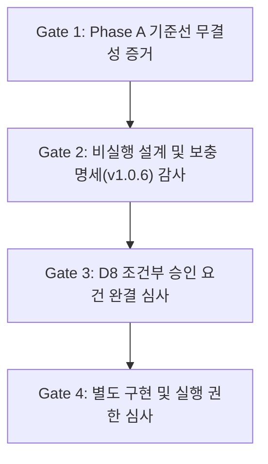

# 📜 SYNAPSE v0.3.34.75 Phase B Verification Supplement v1.0.6 (Draft)
# D8 선결 조건 완결을 위한 검증 보충 명세서

## 📅 문서 메타데이터
- **문서 버전:** v1.0.6 (Verification Supplement Draft)
- **문서 성격:** 📋 비실행 검증 설계 및 감사 결함 보완 명세 (Non-Executable Verification Design Specification)
- **관련 마일스톤:** [v0.3.34.75](file:///home/dogsinatas/TypeScript_project/antigravity-extension-vis/mile_stone/v0.3.34.75.md)
- **관련 기본 계약서:** [v0.3.34.75 Phase B Specification v1.0.5](file:///home/dogsinatas/TypeScript_project/antigravity-extension-vis/mile_stone/v0.3.34.75_phase_b_path_contract.md)
- **관련 제안서:** [v0.3.34.75 D8 Core Graph Generator Freeze Boundary Change Proposal](file:///home/dogsinatas/TypeScript_project/antigravity-extension-vis/mile_stone/v0.3.34.75_d8_freeze_boundary_proposal.md)
- **거버넌스 상태:**
  - **Phase A Baseline:** **ACCEPTED — 영구 불변 고정** (`v0.3.34.75-phase-a-frozen`)
  - **D8 선결 조건:** **IN-PROGRESS (D8 재심사 전 보충 명세 작성 중)**
  - **NodeBuilder.ts 동결 상태:** **RE-FROZEN (수정 권한 미부여, 코드 수정 0줄)**
  - **DataPipeline.ts 동결 상태:** **RE-FROZEN (수정 절대 금지)**
  - **SSoT (`project_state.json`):** **RE-FROZEN (재생성 및 변경 절대 금지)**
  - **Phase B 구현/실행 권한:** **NOT GRANTED (별도 승인 전 착수 절대 금지)**

---

## 1. 개요 및 목적 (Overview & Purpose)

본 보충 명세서는 기존 계약서(v1.0.5)를 덮어쓰지 않고 감사 이력을 투명하게 보존하면서, **마스터 정적 감사에서 지적된 7대 핵심 결함(P0-1 ~ P0-3, P1-1 ~ P1-4)을 코드 변경 없이 순수 검증 설계 수준에서 정밀하게 해소**하기 위해 작성되었습니다.

본 문서는 **Phase B 구현 권한을 요청하는 문서가 아니며**, D8 Core Graph Generator 동결 경계 변경 제안서의 재심사(Stage 3)를 위해 요구되는 **독립 Oracle 비교 방식, 불변식 정의, 실패 및 중단 조건을 사전 확정**하는 것을 유일한 목표로 합니다.

---

## 2. v1.0.5 감사 결함 추적표 (Defect Traceability Matrix)

| 결함 ID | 심각도 | 지적 사항 요약 | 보완 명세 요약 (본 문서의 해결책) |
|---|:---:|---|---|
| **P0-1** | **P0** | L3 검증 대상과 프로덕션 구현의 분리 결함<br>(Transformer 시뮬레이션 결과만 검증하고 실제 NodeBuilder 경로 미검증) | **이원화 검증 프로토콜 수립**: Transformer 시뮬레이션 검증과 별도로, 실제 `NodeBuilder.buildNodes()` 호출 결과를 독립 Oracle과 대조하는 프로덕션 전용 검증 게이트 분리 확정. |
| **P0-2** | **P0** | 검증 독립성 부족 (Build Asset helper 공통 함수 의존) | **독립 Oracle 기준값 정의**: `isBuildOrPackagingAsset` 함수를 공유하지 않고, 파일 확장자·경로 세그먼트·빌드 파일 패턴을 독자 정규식/Set으로 직접 명시한 완전 독립 Oracle Rule 수립. |
| **P0-3** | **P0** | `filePath` 변환 결과에 대한 검증 누락<br>(NodeBuilder 노드 비교 시 `filePath` 제외 후 사후 검증 없음) | **`filePath` 불변식 수립**: $filePath' = M_{path}(filePath)$ 기대값을 독립 계산하여 모든 노드에서 오차 0건임을 단언 검사로 강제. |
| **P1-1** | **P1** | Role 전환 인과관계 미입증<br>(단순 `test` 세그먼트 포함과 실제 규칙 기여도 혼동) | **인과관계 분리 판정**: 세그먼트 단독 기여, 파일명 패턴 단독 기여, 복합 기여를 3개 집합으로 상호 배타적 분리 검증. |
| **P1-2** | **P1** | 전환 ID 집합의 정밀 검증 부재 | **양방향 완전 일치 단언**: Godot 188개, VS Code 93개 고유 ID 집합과의 양방향 공집합($\setminus = \emptyset$) 검사 필수화. |
| **P1-3** | **P1** | 입력 경계 정책 불명확 (빈 문자열 ID 등) | **입력 경계 정책 명문화**: 빈 문자열 ID는 SSoT 규격 위반으로 즉시 거부(`throw Error`)하며, `undefined`와 빈 문자열을 엄격 분리. |
| **P1-4** | **P1** | 역매핑 검증 시 `!originatingId`의 falsy 오류 | **엄격한 `undefined` 검사**: `originatingId === undefined`로 명시적 매핑 부재를 판정. |

---

## 3. 결함별 독립 검증 설계 및 PASS/FAIL 판정 기준 (Verification Design)

### 3.1. [P0-1] 프로덕션 검증 경로와 시뮬레이션 경로의 분리
- **검증 게이트 이원화 원칙**:
  1. **Gate A (Pre-Implementation Simulation Gate)**:
     - 대상: `phase_b_transformer.ts`
     - 성격: 사전 안전성 및 그래프 구조 보존 수학적 시뮬레이션 (`REPORTED SIMULATION PASS`).
  2. **Gate B (Post-Implementation Production Gate)**:
     - 대상: 실제 `NodeBuilder.buildNodes()`가 빌드한 실제 그래프 객체.
     - 성격: 프로덕션 파이프라인 결합 무결성 검증 (`PRODUCTION IMPLEMENTATION PASS`).
- **PASS 기준**: Gate A와 Gate B가 모두 독립적으로 PASS해야 하며, Gate A의 통과를 Gate B의 면제로 간주하지 않음.

### 3.2. [P0-2] 독립 Oracle 기준값 및 의존성 격리
- **문제점**: Transformer와 Auditor가 `src/utils/exclusionRules.ts`의 `isBuildOrPackagingAsset`을 공통 import하여 공통 결함 은폐 위험 존재.
- **해결 설계 (Zero Shared Helper Principle)**:
  - 검증기(Auditor)는 `exclusionRules.ts`를 import하지 않음.
  - 빌드 자산 판정 규칙을 독립 Auditor 내부에 독자적인 리터럴 Set 및 정규식으로 직접 전개:
    ```typescript
    const AUDIT_BUILD_MANIFESTS = new Set(['cargo.toml', 'package.json', 'tsconfig.json', ...]);
    const AUDIT_PACKAGING_DIRS = new Set(['installer', 'packaging', 'ci', '.github', ...]);
    ```
- **PASS 기준**: 독자 Oracle의 결과와 대상 함수의 결과가 1:1 완벽 일치할 것.

### 3.3. [P0-3] `filePath` 정규화 불변식 및 검증 기준
- **수학적 불변식 정의**:
  $$\forall n \in V_{\text{NodeBuilder}}, \quad n'.filePath \equiv \text{auditComputeExpectedPath}(n.filePath)$$
  $$\text{where } n.filePath \equiv n.id \text{ in SSoT}$$
- **검증 규칙**:
  1. `delete origProps.filePath`를 수행한 후, 별도의 단계에서 $n'.filePath$가 독립 계산된 기대 정규화 경로와 일치하는지 전수 검사.
  2. $n'.id \neq n'.filePath$인 노드가 단 1건이라도 발생하면 FAIL.
- **PASS 기준**: 모든 물리 노드에서 $\text{filePath Mismatches} = 0$.

### 3.4. [P1-1] Role 전환 원인의 인과관계 분리 검증
- **3대 전환 원인 집합의 분리**:
  1. **Set $A$ (Pure Segment Trigger)**: 파일명 패턴은 불만족하지만 디렉터리 세그먼트(`tests/*`, `test/*`)에 의해 승격된 노드.
  2. **Set $B$ (Dual Trigger)**: 세그먼트와 파일명 패턴(`.test.`, `.spec.`, `test_` 등)을 동시에 만족하는 노드.
  3. **Set $C$ (Pure File-Pattern Trigger)**: 디렉터리 세그먼트 외부에서 순수 파일명 패턴만으로 승격된 노드.
- **검증 기준**:
  - Godot Engine: Set $A$ 7개, Set $B$ 181개, Set $C$ 0개 ($|A \cup B| = 188$, $|C| = 0$).
  - VS Code: Set $A$ 93개, Set $B$ 0개, Set $C$ 0개 ($|A \cup B| = 93$, $|C| = 0$).
- **PASS 기준**: Set $C$의 크기가 정확히 0이어야 하며, Set $A \cup B$의 합집합이 Allow-list와 100% 일치해야 함.

### 3.5. [P1-2] 전이 ID 집합의 양방향 완전 일치 검증
- **검증 단언식**:
  $$\Delta_{\text{observed}} \setminus \Delta_{\text{allowed}} = \emptyset \quad \land \quad \Delta_{\text{allowed}} \setminus \Delta_{\text{observed}} = \emptyset$$
- **PASS 기준**: 미허용 승격 노드 0건, 누락 승격 노드 0건.

### 3.6. [P1-3 & P1-4] 입력 경계 정책 및 역매핑 안전성
- **입력 정책**:
  - `id === ""` 또는 공백 문자열인 노드는 SSoT 데이터 오염으로 간주하고 파이프라인 진입 즉시 치명적 예외(`throw new Error("Invalid empty node ID")`) 발생.
- **역매핑 단언식**:
  ```typescript
  const origId = invertedMapping.get(transNode.id);
  if (origId === undefined) {
    throw new Error(`[FAIL] No reverse mapping found for transformed node "${transNode.id}"`);
  }
  ```

---

## 4. D8 재심사 증거 목록 및 승인 게이트 (Approval Gates)

D8 Core Graph Generator 동결 경계 변경 제안서의 최종 재심사를 통과하기 위해 요구되는 4단계 승인 게이트입니다:



### 4.1. Gate 1: Phase A 불변 기준선 증거 (완결 보존)
- **Git Tag Object**: `v0.3.34.75-phase-a-frozen` (SHA-1: `4b777713a8832adf298b5b96d0ea16bff094b4ec`)
- **Target Commit**: `9e5292f33473e777ac4d288542abfd29c2bd670d`
- **산출물 해시 보존**: 계약서 및 검증 보고서 SHA-256 불변 유지.

### 4.2. Gate 2: 비실행 설계 및 보충 명세 감사 (현재 단계)
- 본 문서(v1.0.6 Supplement)에 기술된 P0/P1 검증 로직이 마스터의 정적 감사 기준을 충족하는지 심사.
- **통과 조건**: 마스터의 `VERIFICATION SPECIFICATION ACCEPTED` 판정.

### 4.3. Gate 3: D8 제안서 재심사 (선결 조건 종결 판정)
- Gate 1 및 Gate 2의 증거를 기반으로 `mile_stone/v0.3.34.75_d8_freeze_boundary_proposal.md`의 선결 조건(Conditions 1~4) 최종 완결 판정 (`D8 PRE-REQUISITES CLOSED`).

### 4.4. Gate 4: 별도 구현 및 실행 권한 부여 (독립 거버넌스)
- D8 선결 조건이 종결되더라도, 프로덕션 소스코드(`src/core/NodeBuilder.ts`) 수정을 위해서는 마스터의 별도 명시적 권한 부여가 필요함:
  1. **Implementation Authorization**: `NodeBuilder.ts` 국소 수정 승인.
  2. **Execution Authorization**: 테스트 스크립트 실행 승인.
  3. **SSoT Mutate Authorization**: `project_state.json` 갱신 승인 (가장 마지막 단계).

---

## 5. 결론 및 마스터 검토 요청

본 보충 명세서(v1.0.6)는 마스터의 지침을 100% 준수하여 **단 한 줄의 프로덕션 코드나 SSoT 데이터도 변경하지 않고, 순수 검증 설계 및 감사 결함 추적성 완결**을 목표로 작성되었습니다.

본 보충 명세서의 설계 내용에 대한 마스터의 정적 검토를 요청드리며, 승인 전까지 모든 코드 및 실행 동결 상태를 확고히 유지하겠습니다.
